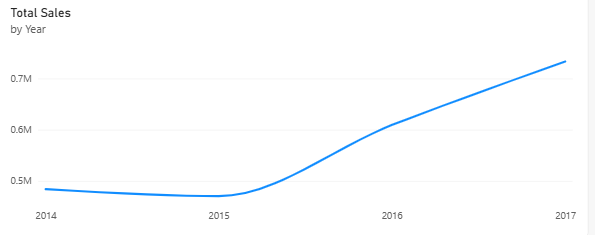
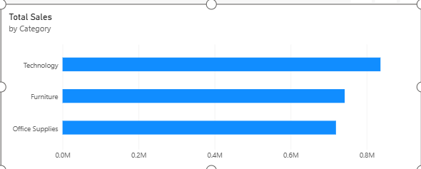
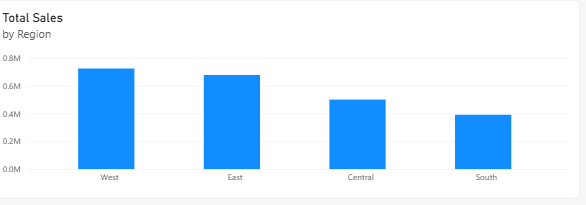
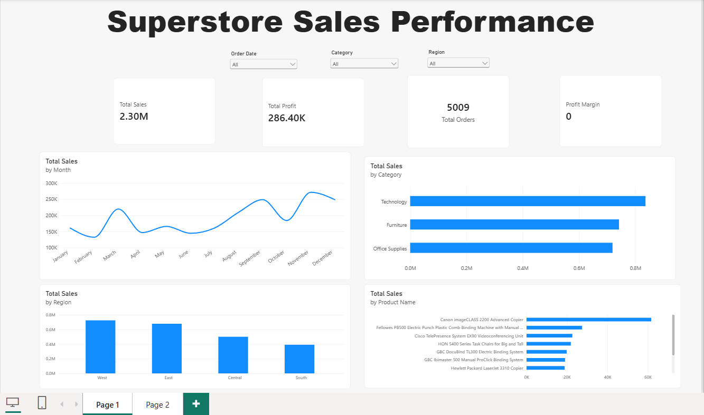
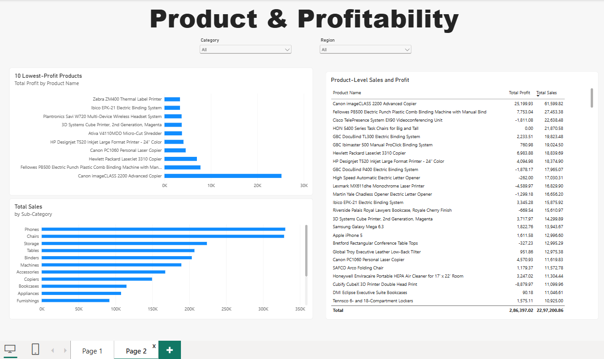

# Business Sales Performance Analytics

An end-to-end analysis of Superstore sales and profitability, moving from data preparation to repeatable Python analysis and an interactive Power BI report. The goal is to turn order-level data into clear views of sales trends, category and regional performance, and product profitability.

## Project workflow

**Excel → Python → Power BI**

### Phase 1 — Excel: data preparation and initial analysis

Prepare and validate the Superstore data before analysis. The quality report and initial sales, category, and regional visuals help check the data and surface useful questions.

- Source data: [`data/Sample - Superstore.csv`](data/Sample%20-%20Superstore.csv)
- Cleaned dataset: [`excel/Superstore_Cleaned_Validated.xlsx`](excel/Superstore_Cleaned_Validated.xlsx)
- Duplicate cleaned dataset copy: [`data/Superstore_Cleaned_Validated.xlsx`](data/Superstore_Cleaned_Validated.xlsx)
- Data quality report: [`reports/Data_Quality_Report.xlsx`](reports/Data_Quality_Report.xlsx)
- Project report: [`reports/Business Sales Performance Analytics.pdf`](reports/Business%20Sales%20Performance%20Analytics.pdf) · [editable DOCX](reports/Business%20Sales%20Performance%20Analytics.docx)

**Sales trend**



**Category and regional performance**

| Category performance | Regional performance |
|---|---|
|  |  |

### Phase 2 — Python: repeatable analysis

The Python script reads the cleaned workbook and calculates overall KPIs and sales/profit summaries by time, category, sub-category, region, and product. It writes a results workbook and CSV summaries and displays a monthly sales chart.

- Analysis script: [`python/superstore_analysis.py`](python/superstore_analysis.py)
- Run instructions: [`python/Python_Analysis_Readme.txt`](python/Python_Analysis_Readme.txt)
- Results workbook: [`python/Superstore_Python_Analysis.xlsx`](python/Superstore_Python_Analysis.xlsx)
- Monthly summary: [`python/monthly_trends.csv`](python/monthly_trends.csv)
- Category summary: [`python/category_analysis.csv`](python/category_analysis.csv)
- Regional summary: [`python/region_analysis.csv`](python/region_analysis.csv)

To run the analysis from the project root:

```bash
python -m pip install pandas numpy matplotlib openpyxl
python python/superstore_analysis.py
```

The script uses the cleaned workbook in `python/` when present, or falls back to `excel/`. It writes the results workbook and CSV files beside the script.

### Phase 3 — Power BI: interactive dashboards

Explore sales performance and product profitability in the interactive Power BI report. The screenshots below are static previews; open the `.pbix` file in Power BI Desktop to use the report.

- Power BI report: [`powerbi/Superstore_Sales_Dashboard.pbix`](powerbi/Superstore_Sales_Dashboard.pbix)

**Sales performance dashboard**



**Product and profitability dashboard**



## Repository contents

```text
data/
  Sample - Superstore.csv
  Superstore_Cleaned_Validated.xlsx
excel/
  Superstore_Cleaned_Validated.xlsx
powerbi/
  Superstore_Sales_Dashboard.pbix
python/
  category_analysis.csv
  monthly_trends.csv
  Python_Analysis_Readme.txt
  region_analysis.csv
  superstore_analysis.py
  Superstore_Python_Analysis.xlsx
reports/
  Business Sales Performance Analytics.docx
  Business Sales Performance Analytics.pdf
  Data_Quality_Report.xlsx
visuals/
  category_performance.png
  product_profitability_dashboard.png.png
  regional_performance.png
  sales_performance_dashboard.png
  yearly_sales_trend.png
```

## Future implementation roadmap

The current analysis is a useful descriptive baseline. These are potential next steps—not features already included in the project:

1. **Add forecasting with a proper time-based evaluation.** Compare simple seasonal baselines with forecasting methods, and report how well they perform on held-out periods before using projections.
2. **Study discount and margin trade-offs.** Check how discount levels relate to profit by product, category, and region; treat the results as associations unless supported by a stronger causal design.
3. **Make the dashboard easier to monitor.** Add clearly defined KPI targets, time-period comparisons, and focused views for loss-making products and changing regional performance.
4. **Prepare a repeatable refresh workflow.** Document input checks, data refresh steps, and validation rules so future data updates can be compared consistently.

Any business action based on these extensions should be tested against updated data and operational context rather than inferred from a historical association alone.
